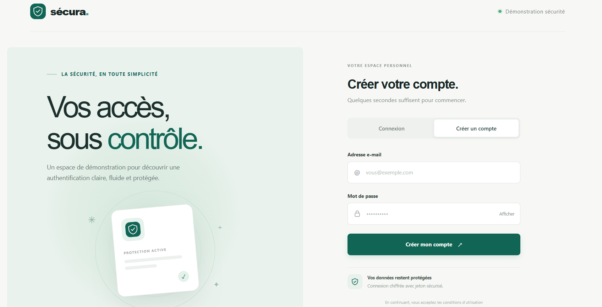
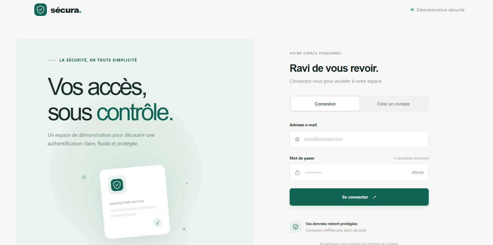
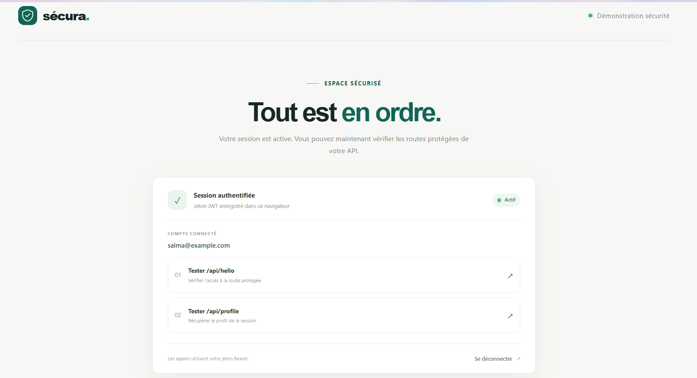
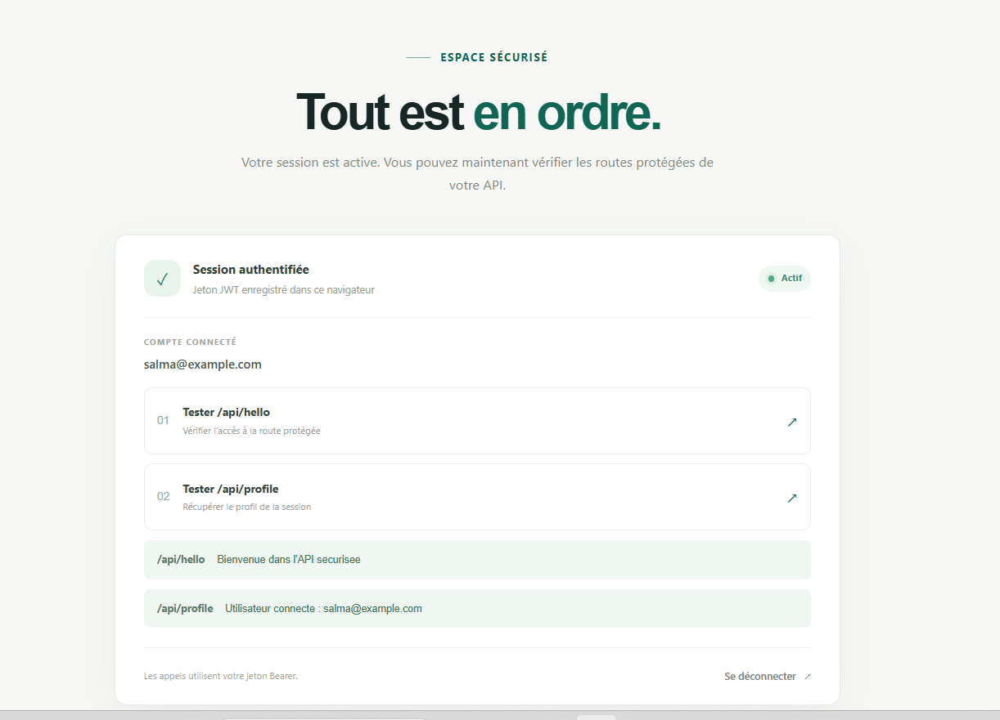

# Sécura — Interface React

Interface React de démonstration pour l’API d’authentification Spring Boot du dépôt. Elle permet de créer un compte, de se connecter et de tester les routes API protégées par JWT.

## Captures d’écran

### Inscription et connexion

<p align="center">
  
  
</p>

### Session connectée et routes API

<p align="center">
  
  
</p>

## Démarrage

Depuis ce dossier, installez les dépendances et démarrez Vite :

```bash
npm install
npm run dev
```

Le backend Spring Boot doit également être lancé sur `http://localhost:8081`. Consultez le [README principal](../readme.md) pour les instructions complètes.
