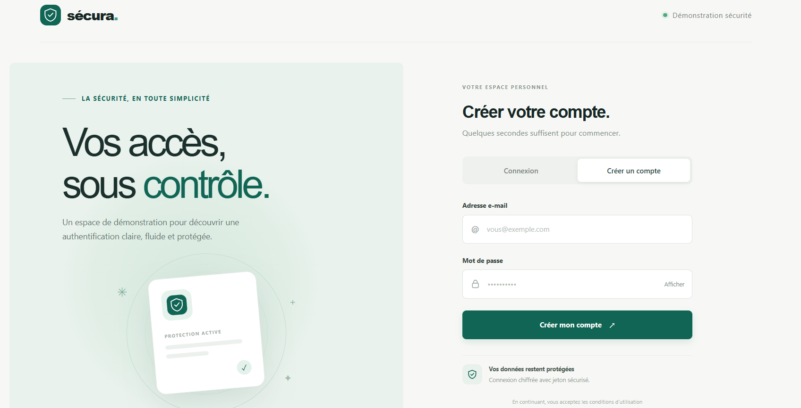
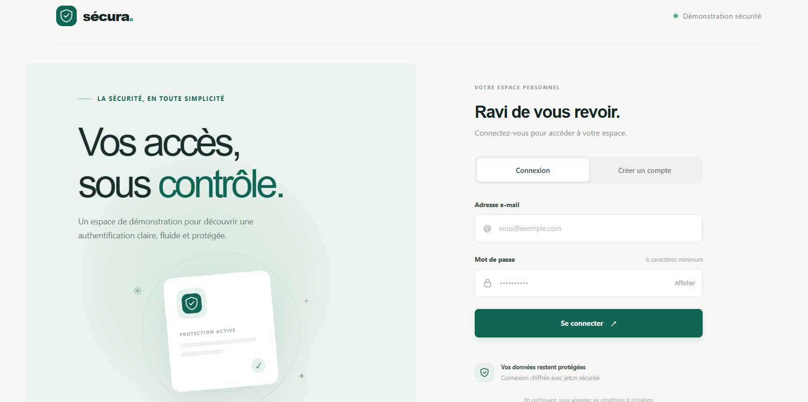
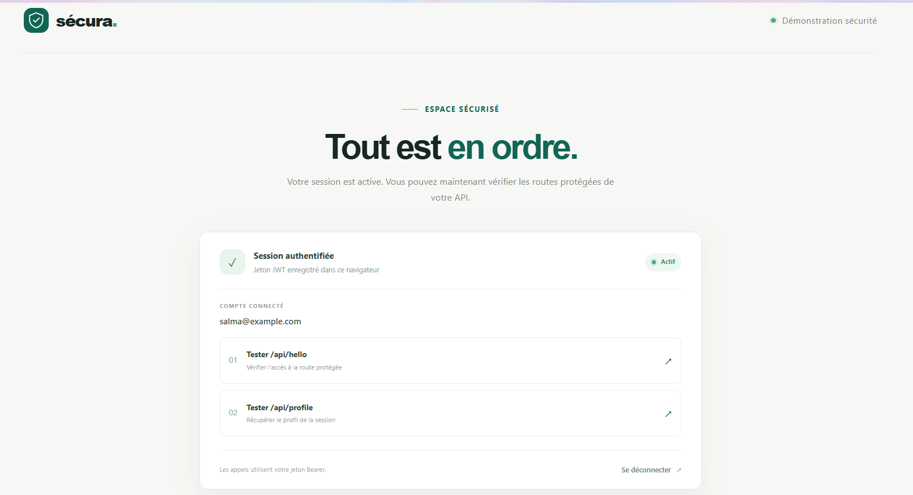
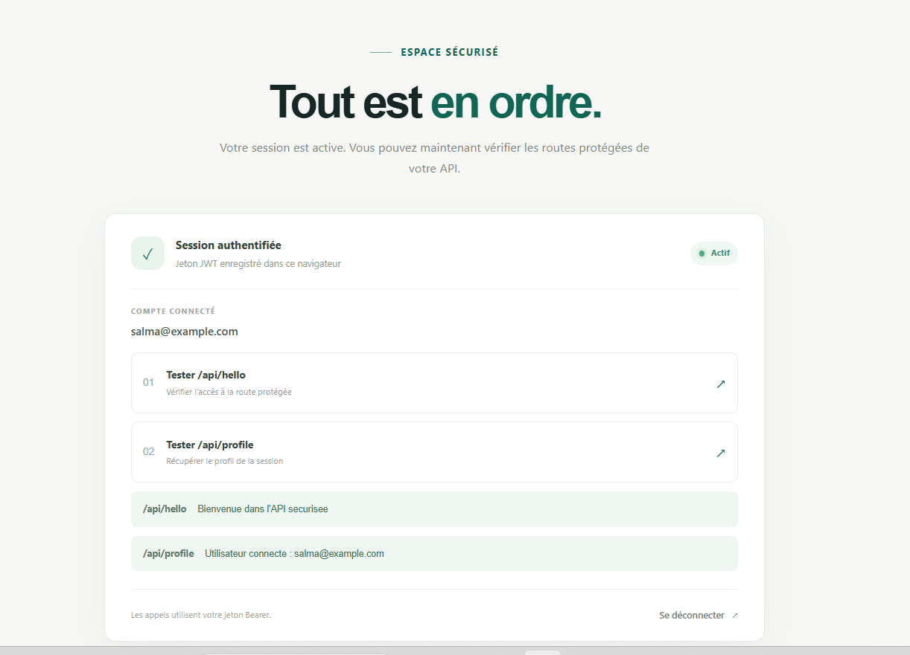

# Sécura — Authentification sécurisée

Application de démonstration qui associe une API **Spring Boot** à une interface **React**. Elle permet de créer un compte, de se connecter, puis d’appeler des routes protégées en transmettant un jeton JWT.

## Fonctionnalités

- Inscription et connexion avec adresse e-mail et mot de passe.
- Création et validation du JWT par l’API existante.
- Conservation du jeton en mémoire pendant la session de démonstration.
- Appels authentifiés vers `/api/hello` et `/api/profile`.
- Interface responsive en français avec états de chargement et retours d’erreur.
- Base H2 en mémoire pour les comptes de démonstration.

## Captures d’écran

### Création du compte et connexion

<p align="center">
  
  
</p>

### Session authentifiée et réponses de l’API

<p align="center">
  
  
</p>

## Prérequis

- **Java** compatible avec la version Spring Boot du projet.
- **Node.js** et **npm** pour le frontend.

## Démarrage local

Le backend et le frontend doivent fonctionner en même temps, dans deux terminaux.

### 1. Démarrer le backend

Depuis la racine du dépôt :

```powershell
.\mvnw.cmd spring-boot:run
```

L’API écoute sur `http://localhost:8081`.

### 2. Démarrer le frontend

Dans un second terminal :

```powershell
cd my-react-app
npm install
npm run dev
```

Ouvrir l’adresse affichée par Vite, généralement `http://localhost:5173`. Le serveur de développement transmet automatiquement `/auth` et `/api` au backend sur le port `8081`.

## Parcours d’utilisation

1. Dans l’onglet **Créer un compte**, saisir une adresse e-mail et un mot de passe d’au moins 6 caractères.
2. Après la confirmation, ouvrir **Connexion** et utiliser les mêmes identifiants.
3. Dans l’espace sécurisé, cliquer sur **Tester `/api/hello`**, puis sur **Tester `/api/profile`**.
4. Vérifier les réponses affichées sous les boutons, puis cliquer sur **Se déconnecter** pour terminer la session.

Les captures montrent les deux formulaires, l’espace authentifié, et les réponses de succès de l’API pour le compte de démonstration `salma@example.com`.

## Routes de l’API

| Méthode | Route | Requête / résultat |
| --- | --- | --- |
| `POST` | `/auth/register` | Corps JSON : `{ "email": "nom@exemple.com", "password": "..." }`. Crée un compte. |
| `POST` | `/auth/login` | Même format de corps. Renvoie un JWT à la connexion réussie. |
| `GET` | `/api/hello` | Route protégée ; renvoie un message de bienvenue. |
| `GET` | `/api/profile` | Route protégée ; renvoie l’identité du compte connecté. |

Pour les deux routes `/api`, le frontend transmet le jeton dans l’en-tête :

```http
Authorization: Bearer <jeton>
```

## Base H2

La configuration fournie utilise H2 en mémoire. La console se trouve à `http://localhost:8081/h2-console/`.

| Paramètre | Valeur |
| --- | --- |
| JDBC URL | `jdbc:h2:mem:securitydb` |
| Utilisateur | `sa` |
| Mot de passe | laisser vide |

Les données sont perdues à l’arrêt du backend, puis la base est recréée au prochain démarrage. La console H2 est facultative : elle n’est pas nécessaire pour utiliser le frontend.

### Si la console H2 renvoie 403

Un HTTP 403 indique que Spring Security refuse la requête. Vérifier que la console est activée avec `spring.h2.console.enabled=true`, puis que la configuration de sécurité autorise `/h2-console` et `/h2-console/**` et exempte ces routes de la protection CSRF. L’URL avec barre oblique finale peut également être essayée : `http://localhost:8081/h2-console/`.

## Dépannage

- **Le frontend s’affiche, mais l’API est inaccessible** : vérifier que le backend tourne bien sur le port `8081`.
- **Connexion ou inscription refusée avec 401/403** : vérifier dans la configuration Spring Security que `/auth/**` est accessible sans jeton préalable et que la protection CSRF est adaptée aux requêtes de l’API.
- **La console H2 est inaccessible** : consulter la section [Base H2](#base-h2) et vérifier les règles de sécurité associées à la console.
- **Un compte disparaît après le redémarrage** : c’est normal pour la base H2 en mémoire de cette démonstration.

## Structure du dépôt

```text
demo.SD/
├── my-react-app/       # Interface React et configuration Vite
├── src/main/java/      # API Spring Boot
├── src/main/resources/ # Configuration de l’application et de H2
└── screens/            # Captures affichées dans les README
```
